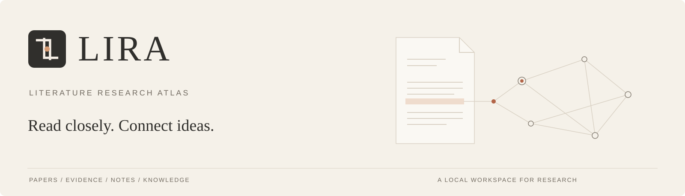
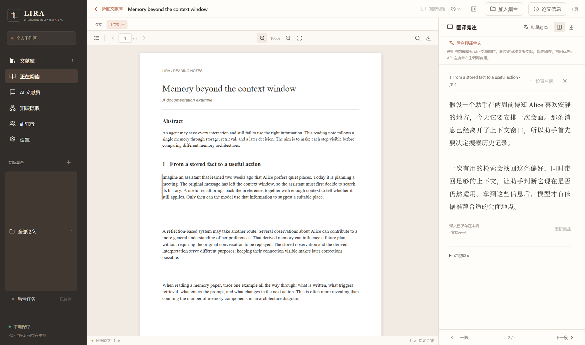

<p align="center">
  
</p>

<h3 align="center">论文阅读 · 知识摄取 · 专题研究</h3>

<p align="center">在原文中理解细节，在专题中建立联系。</p>

<p align="center">
  <a href="#阅读与问答">📖&nbsp;阅读与问答</a> &nbsp;|&nbsp;
  <a href="#知识摄取">🧩&nbsp;知识摄取</a> &nbsp;|&nbsp;
  <a href="#后台研究">🔎&nbsp;后台研究</a> &nbsp;|&nbsp;
  <a href="#开始使用">🚀&nbsp;开始使用</a> &nbsp;|&nbsp;
  <a href="docs/README.md">📚&nbsp;文档</a>
</p>

---

LIRA 是一个本地优先的论文阅读与科研知识管理工具。原始 PDF、段落译文、阅读对话、个人笔记和跨论文关系放在同一个工作环境里，适合从精读一篇论文逐渐深入一个研究方向。

它关注阅读之后的积累：一篇工作提出了什么方法，用什么数据和指标验证，与前人有什么联系；这些信息可以带着原文出处进入专题，成为之后比较方法、复习机制和寻找研究问题的材料。

<p align="center">
  
</p>

<p align="center"><sub>实际阅读器截图，使用独立演示库。论文与译文为文档示例。</sub></p>

## 工作方式

| 正在做的事 | LIRA 提供的支持 |
| --- | --- |
| 读一篇陌生论文 | 保留版式的 PDF 阅读、段落翻译、选区与图表问答 |
| 记住关键细节 | 高亮、带原文位置的笔记、论文卡片与可展开的依据 |
| 整理一个方向 | 专题集合、技术时间线、方法演进、论文比较、对象档案 |
| 回答跨论文问题 | AI 文献员检索选定资料，结合原文、卡片和个人笔记回答 |
| 让积累持续生长 | 后台预译、AI 知识整理、专题文章、研究线索与复习题 |

论文、笔记、译文和对话保存在本机。导入、原文阅读、全文搜索和记笔记无需模型；翻译、问答与智能整理使用你在应用内配置的模型连接。


## 阅读与问答

### 保留原文，按自己的节奏读

PDF 连续滚动，支持目录、页码、缩放和全文查找。切换中英对照后，英文原版保持可见；把鼠标移到段落上，即可展开中文译文。译文可以放在右侧或下方，公式使用 KaTeX 排版。阅读位置和已经保存的结果会保留，重新打开可以接着读。

短词可以通过词典速译；需要理解一段话时再使用模型翻译。批量选择多段后，队列逐段保存结果，完成一段就能读一段。也可以提前预译整篇正文，默认在附录或参考文献处停止；后面的内容仍可按需翻译。

### 问一句具体的问题

划选原文或译文，可以直接用自然语言提问，例如「这里的 EM 是怎么计算的？」。阅读对话保留选中的文字与对应英文依据，回答时结合论文上下文查找相关材料。识别出的图表也可以单独选择，用于询问指标、实验设置或图中的机制。

等待时可以收起对话继续阅读，之后从「阅读对话」或历史记录找回。问题、回答及提问区域一起保存，回看时能知道当时在问什么。图表问答涉及图像输入，需要所选模型支持相应能力。

### 笔记与结论都能回到出处

只想勾画重点时，保存高亮即可；想记录想法时，再把选区引用到笔记。笔记支持阅读记录、研究想法、问题和待办等类型，正文与引用中的公式采用统一排版。

全文分析会整理问题、方法、实验结果、局限与章节要点。论文卡片的结论可以展开依据，查看原句、章节和页码，再跳回 PDF。原文证据与个人判断分别保存，便于以后重新核对。

## 知识摄取

读同一领域的论文时，困难常在于把细节接起来：两篇文章是否在说同一个方法？一个基准衡量的究竟是哪种能力？新工作采用了前人的组件，还是改变了核心机制？

LIRA 将论文中的对象、对象在当前论文中的角色，以及它们之间的关系分开记录。这样，同一个名字可以跨论文复用，关系也能保留具体含义与来源。

### 一篇论文留下什么

| 层次 | 保存的信息 | 之后怎样使用 |
| --- | --- | --- |
| 论文理解 | 研究问题、方法机制、关键结果与局限 | 复习整篇工作，在比较时快速恢复背景 |
| 核心对象 | 方法、数据集、benchmark、任务、指标与概念 | 找到同一对象出现过的论文和相关原文 |
| 论文内角色 | 本文贡献、相关工作、基线对照、变体消融或评测支撑 | 把核心方法与实验中的辅助条目区分开 |
| 对象关系 | 基于、扩展、对比、使用数据集、接受评测等 | 追踪设计来源，理解方法演进与评测选择 |
| 来源与维护记录 | 原文片段、页码、规范名称、别名与变更记录 | 核对整理结果，处理歧义和后续修正 |


### 同一对象，积累多份来源

每篇论文里出现的条目先保留自己的原文语境，再关联到跨论文的规范对象。名称、缩写与别名用于识别已有对象；有歧义的匹配会留下来继续核对。数据集与 benchmark 等不同类型分别维护，避免仅因同名就混成一个条目。

打开对象档案，可以查看说明、别名、相关论文、原文证据、已记录的外部链接和维护历史。随着新论文加入，同一方法或数据集的材料会逐渐汇聚，复习时不必重新翻遍每篇论文。

### 用不同视图回答不同问题

- **技术时间线**：按年份与发表信息浏览工作，恢复研究背景。
- **引用与方法关系**：查看论文之间已记录的联系，并区分关系来源。
- **方法演进**：突出主方法与演进主线，另外展开基线、消融、组件和评测支撑。
- **论文比较**：选择 2–4 篇论文，对照问题、方法、结果与局限，缺失项保留状态提示。
- **对象目录**：按类型或名称检索，进入实体档案追踪相关论文与证据。

### 交给 AI 整理，保留必要的判断

「AI 知识整理」会结合论文正文检查已有条目，补充有依据的对象、核对关系，并尝试补全可验证的发表信息。证据充分且满足安全条件的决定可以自动处理；名称歧义、语义合并和与人工决定冲突的修改仍会留下待处理事项。自动整理保留变更记录，支持回看和撤销。

已经检查过一篇论文，与所有条目都已确认，是两种状态：前者表示一次整理完成，后者描述当前知识的确定程度。界面分别显示整理论文的进度与仍待确认的条目，方便决定是否还需要介入。

操作与数据结构的详细解释见 [知识摄取与网络整理](docs/KNOWLEDGE.md)。

## 跨论文检索

在 AI 文献员中选择全库、专题集合或指定论文，可以围绕一个问题调取书目、原文、卡片和个人笔记。例如：

> 这个专题中的几种记忆机制，分别在什么时机写入和检索？有哪些实验真正检验了记忆的作用？

回答中的引用可以展开，查看摘录并回到对应论文。对话历史自动保存在本机，打开原文后也能返回继续讨论。文献员以只读方式使用研究资料，不会将回答自动改写为你的笔记。

资料较多时，限定专题或指定论文能让比较更集中。搜索以本地全文索引为基础，模型会辅助组织检索和回答；当前没有 embedding 语义索引，也不把一次检索未命中当作知识不存在。

## 后台研究

除了阅读时即时调用模型，LIRA 也可以在空闲时继续处理已有材料。每个专题可以设置研究方向、选择任务类型，并决定哪些工作交给后台。

| 任务 | 产出 |
| --- | --- |
| 正文预译 | 逐段保存的译文，可边读边用，支持暂停、继续与失败重试 |
| 全文分析 | 论文卡片、章节要点及支撑结论的原文依据 |
| AI 知识整理 | 对象和关系的核对、补充、去重及维护记录 |
| 专题文章 | 结合多篇论文讲清设计动机与机制，保留来源、历史版本及 Markdown 导出 |
| 研究线索 | 方法联系、知识缺口、可验证的研究问题与复习题 |
| 跟进阅读疑问 | 从问题笔记与未完成的提问出发，继续寻找解释与依据 |

后台任务统一展示进度、等待原因和结果入口。预译在阅读时也能继续，前台翻译与问答优先取得下一个可用位置；专题研究和知识维护主要在空闲时推进。已经发出的请求会先完成并保存结果。

API 请求按各连接的并发设置调度；官方账号的连接共享本地并发与额度状态，遇到限流会降低并发。可选后台研究遵守额度保留线、调用预算与所选资料范围，不会为了填满队列无限产生任务。具体激活步骤见 [后台任务与调度](docs/BACKGROUND_TASKS.md)。

## 开始使用

### 启动

源码启动需要 **Python 3.11+、Node.js 20+ 和 Git**。下面的启动脚本用于 Windows；访问当前私有仓库需要相应权限。

```powershell
git clone https://github.com/prummn/lira.git
cd lira
.\scripts\start.ps1
```

脚本安装依赖，首次运行或源码更新时先构建界面，确认服务和页面资源可用后打开浏览器。日常启动复用构建结果；端口被占用时自动选择空闲端口。以后可以双击根目录的 **「启动工作台.cmd」**。停止服务：

```powershell
.\scripts\stop.ps1
```

### 导入与连接模型

在文献库拖入 PDF，或通过 arXiv / 公开 PDF 链接导入。每批可以选择只入库，或预译正文并后台分析；原文准备好即可开始阅读。

在 **「设置 → 模型连接」** 中添加 API 或登录 ChatGPT Codex。支持多份连接、主连接切换及部分任务的备用路由；模型、协议、超时与并发在应用内管理。配置步骤与兼容性说明见 [模型连接](docs/MODELS.md)。

## 文档与开发

| 文档 | 内容 |
| --- | --- |
| [使用指南](docs/USER_GUIDE.md) | 从导入、阅读和提问，到笔记与专题的日常操作 |
| [知识摄取](docs/KNOWLEDGE.md) | 对象、别名、关系、来源和 AI 整理的工作方式 |
| [后台任务](docs/BACKGROUND_TASKS.md) | 启用任务、查看进度、调整额度与理解等待原因 |
| [模型连接](docs/MODELS.md) | API / Codex 配置、多连接切换和常见故障 |
| [工作流与排错](docs/WORKFLOWS.md) | 常用操作路径、状态区别与恢复入口 |
| [参与开发](CONTRIBUTING.md) | 环境、目录、测试与协作约定 |
| [安全与隐私](SECURITY.md) | 本地数据、外部请求和敏感信息处理 |

前端使用 React、TypeScript、Vite、PDF.js 和 KaTeX；后端使用 FastAPI、PyMuPDF、SQLAlchemy、SQLite FTS5 和 Alembic。界面、模型适配器与后台任务代码都在本仓库内。

```powershell
.\backend\.venv\Scripts\python.exe -m pytest backend/tests -q
npm.cmd --prefix frontend run build
```

浏览器测试使用隔离文献库。GitHub Actions 执行凭证扫描、后端测试和前端构建；维护流程与验证范围在对应文档中说明。

## 数据与当前范围

开发版默认数据库为 `backend/paper_reader.db`，原始 PDF 在 `backend/storage/`。备份前停止服务，同时复制数据库、同名 `-wal` / `-shm` 文件（若存在）和 PDF 目录。模型配置、登录状态与个人资料已加入 Git 忽略规则。

LIRA 目前面向本机个人使用，持续迭代中。支持带文本层的 PDF；尚不支持 CAJ、OCR、Zotero 导入和任意 DOI 全文下载。复杂版面仍可能出现分段或图表识别偏差。来源定位用于核对材料，模型整理与推断仍需结合原文判断。

仓库当前保持私有，尚未选择开源许可证。公开前会单独确认代码、依赖与素材的许可范围。
