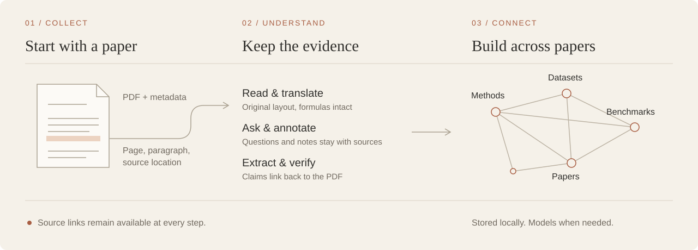

<p align="center">
  
</p>

<p align="center">
  本地论文阅读与科研知识管理工具<br>
  <a href="#开始使用">开始使用</a> · <a href="docs/WORKFLOWS.md">使用文档</a> · <a href="CONTRIBUTING.md">参与开发</a> · <a href="docs/DISTRIBUTION.md">打包与发布</a>
</p>

读完一篇论文，留下的往往是几处高亮、几段对话，以及过一阵就想不起出处的结论。LIRA 把这些内容放回同一个阅读环境：保留原始 PDF，在段落旁翻译、提问和记笔记，再把方法、数据集与相关工作连到专题中。复习时可以沿着结论回到原文。

论文、笔记、译文和对话保存在本机。基础阅读无需模型；需要翻译、问答或知识整理时，使用你在应用内配置的连接。

<p align="center">
  
</p>

<p align="center"><sub>实际应用截图，使用独立演示库。论文与译文为文档示例。</sub></p>

## 阅读时用得上

- **原文与译文并排读。** PDF 连续滚动，保留公式、图表和排版。逐段翻译、批量翻译或提前预译正文；完成一段就能读一段，其他任务在后台继续。
- **围绕具体内容提问。** 划选原文、译文或选择已识别图表，带着上下文发问。等待时可以继续阅读，之后从历史记录找回问题、选区和回答。
- **让笔记留在出处旁。** 高亮、摘录和笔记带着页码与原文位置保存。论文卡片中的结论也能展开依据，再跳回 PDF 核对。

## 从单篇读到一个专题

论文按专题集合组织。AI 文献员可以在选定资料内检索和回答；知识摄取提取方法、数据集、指标及关系，供时间线、论文比较和概念索引使用。跨论文的同一对象可以归并，条目保留来源，便于后续维护。



可选的后台研究会整理专题导读、检查论文联系与知识缺口，并维护已有知识网络。任务受连接、额度保留线和并发设置约束；前台请求优先取得可用位置。进度、等待原因、暂停和重试统一显示在「后台任务」。

## 开始使用

### Windows 试用包

拿到维护者提供的 ZIP 后，完整解压，双击 **「启动 LIRA.cmd」**。无需另装 Python 或 Node.js；首次启动为空库，在「设置 → 模型连接」配置自己的连接即可。结束使用时运行 **「停止 LIRA.cmd」**。

试用包数据保存在 `%LOCALAPPDATA%\LIRA`。升级、备份和发布步骤见 [分发说明](docs/DISTRIBUTION.md)。

### 从源码启动

需要 **Python 3.11+、Node.js 20+ 和 Git**。当前启动与分发流程以 Windows 为主；访问私有仓库需要相应权限。

```powershell
git clone https://github.com/prummn/lira.git
cd lira
.\scripts\start.ps1
```

脚本安装依赖、启动服务并打开浏览器；端口被占用时自动选择空闲端口。以后也可以双击根目录的 **「启动工作台.cmd」**。

```powershell
.\scripts\stop.ps1
```

在文献库拖入 PDF，或通过 arXiv / 公开 PDF 链接导入。每批可以选择只入库，或预译正文并后台分析；原文准备好后即可阅读，无需等待全文分析结束。

### 连接模型

在 **「设置 → 模型连接」** 中添加和切换连接，支持 OpenAI 兼容的 Responses / Chat Completions API，也支持通过官方 CLI 登录 ChatGPT Codex。不同服务的模型能力、可用额度和并发限制以实际账号为准。

无需手工编辑配置文件。已有译文、笔记和对话可随时回看；新的远端任务会把对应原文、上下文及必要图像发送给所选服务。详见 [模型配置与完整工作流](docs/WORKFLOWS.md#模型配置可选)。

## 数据与项目结构

开发版默认将数据库保存在 `backend/paper_reader.db`，PDF 保存在 `backend/storage/`；分发版使用独立数据目录。备份前停止服务，同时复制数据库及其同名 `-wal` / `-shm` 文件（若存在）和 PDF 目录。账号、配置与个人资料不进入 Git，详见 [安全与隐私](SECURITY.md)。

| 目录 | 内容 |
| --- | --- |
| `frontend/` | React、TypeScript、Vite；PDF.js 阅读器与 KaTeX 公式排版 |
| `backend/` | FastAPI、PyMuPDF；SQLAlchemy、SQLite FTS5 与 Alembic |
| `scripts/` | 本地启停、隔离测试、Windows 构建和发布 |
| `docs/` | 使用说明、验证记录与设计资料 |

### 开发与协作

环境、分支约定和浏览器回归见 [CONTRIBUTING.md](CONTRIBUTING.md)。常用检查：

```powershell
.\backend\.venv\Scripts\python.exe -m pytest backend/tests -q
npm.cmd --prefix frontend run build
```

浏览器测试使用临时文献库；Windows 发布通过 `.\scripts\release.ps1` 完成构建、数据检查和隔离验收。GitHub Actions 执行凭证扫描、后端测试和前端构建。

## 当前边界

LIRA 目前面向本机个人使用，持续迭代中。支持带文本层的 PDF；尚不支持 CAJ、OCR、Zotero 导入和任意 DOI 全文下载。复杂版面可能出现分段或图表识别偏差，模型分析也需要结合原文判断。来源定位帮助核对材料，不能替代对结论的检验。

仓库当前为私有协作项目，尚未选择开源许可证。公开前会另行确认代码、依赖与素材的许可范围。
