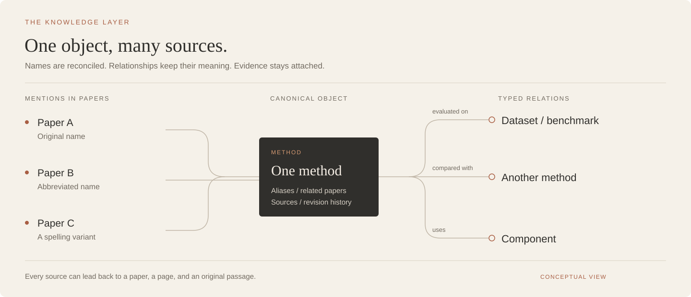

# 知识摄取与网络整理

[文档目录](README.md) &nbsp;|&nbsp; [使用指南](USER_GUIDE.md) &nbsp;|&nbsp; [后台任务](BACKGROUND_TASKS.md)

知识摄取把论文中的方法、数据和评测信息整理成可以跨论文使用的记录。核心是保留三个层次：某篇论文怎样提到一个对象，这个对象在全库中是谁，以及原文支持它与其他对象存在什么关系。

## 从哪里开始

先把相关论文加入一个专题集合，再打开「知识摄取」选择该专题。全文分析会产生知识摄取材料；「AI 知识整理」还可以独立核对已有正文与候选条目。只要已经有可读正文，全文卡片失败也不必阻塞知识整理，但两者的完成状态分别记录。

第一次阅读可以先看论文卡片与原文；已经积累过知识的专题，则适合从方法演进或对象目录进入，找到已有线索后补读新论文。

## 对象、提及和角色

| 记录 | 表达什么 | 示例 |
| --- | --- | --- |
| 论文中的提及 | 对象在当前论文中的名称、说明与原文位置 | Related Work 中的一项前人方法 |
| 规范对象 | 跨论文共用的名称、类型、别名与说明 | 同一方法的全称和缩写 |
| 论文内角色 | 该对象在这篇工作里起什么作用 | 核心贡献、对照、消融或评测支撑 |

支持的方法、数据集、benchmark、任务、指标、概念、论文及会议/期刊等类型分别维护。同名的数据集与评测任务不应仅因拼写相同就合并；一个很少用的实验指标可以保留出处，同时不必进入方法主线。

不同论文的提及关联到同一规范对象后，相关论文与证据会在档案中汇集。名称规范化和别名有助于减少重复；语义存在歧义时仍需核对原文。

## 关系要表达具体含义

方法关系支持基于、扩展、对比、替代、启发、使用数据集、接受评测及概念依赖等类型。引用一篇论文，采用它的方法，与在实验中把它当作基线，含义不同。关系记录需要包含两端对象、类型、说明与原文依据。

时间先后也不自动构成继承关系。方法演进应由已记录的关系支撑，不能只把若干论文按年份连线。

## 怎样浏览已有知识

| 视图 | 适合回答的问题 |
| --- | --- |
| 技术时间线 | 这些工作何时出现，发表信息与设计背景是什么？ |
| 引用与方法关系 | 哪些论文有已记录联系，依据来自哪里？ |
| 方法演进 | 核心方法怎样连接？哪些是基线、消融、组件或评测支撑？ |
| 论文比较 | 2–4 篇工作的问题、方法、结果和局限有何不同？ |
| 概念索引 | 某个概念出现在哪些已分析论文中？ |
| 对象目录 | 规范对象的说明、别名、相关论文、链接和记录有哪些？ |
| 待确认 | 哪些对象或关系仍需决定，或存在冲突？ |

对象档案与来源定位可以相互跳转：从关系进入对象，从对象查看相关论文，再打开支持这条记录的原文。

## AI 整理怎样减少手工工作

在「AI 知识整理」启动当前范围整理，或在后台设置中开启自动知识整理。系统逐篇核对正文和现有材料，检查遗漏的核心对象、规范名称、关系支持与发表信息。

自动决定同时依赖模型判断、可核验的原文与操作的安全范围。高置信度且符合条件的补充、关联和清理可以自动完成，保留变更记录。歧义匹配、需要改写语义的合并或拆分、证据不足以及人工修改过的对象会更保守地处理。人工已忽略的内容不会因为后台再次运行就自动恢复。

自动整理的目标是减少反复确认相同信息；目前仍可能留下需要审阅的条目，不能保证整个专题一次全部厘清。查看维护记录可以追踪修改，并撤销支持撤销的自动变更。

## 分清两种进度

**待检查论文**表示当前范围中尚未完成核对的工作；**待确认对象和关系**表示仍未解决的知识条目。论文已经检查完，也可能因某些关系不明确而留下待确认项。

如果一篇论文看起来没有处理完整，先查看它在整理队列中的状态，再查看本轮的原文覆盖与未处理条目。失败或部分覆盖可以重试；不需要删除论文重新导入。

## 使用边界

当前网络来自本地论文及已保存的整理结果，不是完整的外部学术引用图。对象链接只展示已记录的地址；发表信息补全受来源服务可用性影响。复杂版面或较长论文可能导致原文覆盖不足，模型给出的关系也可能需要纠正。

原文匹配证明引用片段存在于文件中，对象身份与关系解释是否成立仍需结合语境判断。重要研究结论应回到原始论文核对。
